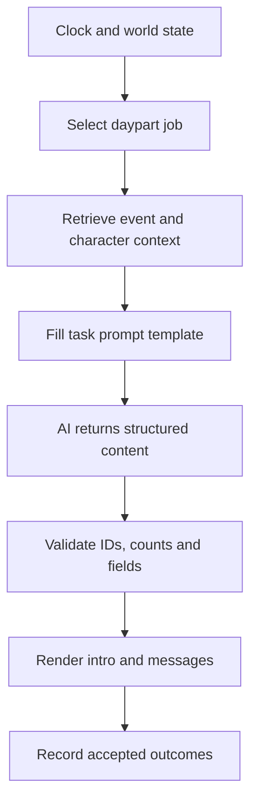

# Modular AI Game Framework
## Product and technical design document — v0.5

Date: 23 September 2026  
Status: Direction and prompt-based harness inference are in sections 0, 22, and 23. Section 24 reports a playable 0.2 implementation. Sections 1–21 preserve earlier proposals and prototype history.  
Working label: Story Framework. This is a placeholder, not a game title.

## 0. Corrected vision — an AI-driven world game harness

The intended product is a reusable **game runtime**, not primarily a worldbuilding assistant and not primarily a menu of predefined actions. A future developer authors a world through locations, lorebooks, characters, objects, rules, and presentation assets. A player then enters that world and speaks or acts through a conversational interface: “Look under the desk,” “Ask the keeper about the missing map,” “Put the key in my bag,” or “Go through the arch.” The game locates the relevant world information, uses an AI to interpret and narrate the interaction, records what happened, and carries those consequences forward.

The first full game is intended to be an **adult eroge / dating simulation**, drawing on social simulations such as Venus University and supporting optional NSFW scenes. This is the product priority, while the **core harness must not hard-code school, fantasy, romance, or isekai assumptions**. Dating, adult intimacy, route tempo, jealousy, and related mechanics belong in optional modules. A different setting or a non-adult release should come from a different pack and module selection.

The adult game should support deliberately uneven route structures: slow-burn romances with authored turning points, normal dating routes, short automatic routes, consensual hookups, recurring casual partners, and unavailable characters. “Easy” describes pacing and prerequisites, never an exception to adult-only casting, orientation, boundaries, ongoing consent, or withdrawal.

The correct priority is **world exploration through AI conversation backed by structured, persistent state**. The previous prototype demonstrates a few useful pieces—module loading, event persistence, provider adapters, knowledge filtering—but its action buttons, fixed short fixtures, and limited context selection are not the desired experience. Section 22 specifies the replacement loop and milestones. No implementation of that revised loop is claimed here.

## 1. Purpose and agreed direction

Build a reusable harness for single-player, AI-driven narrative simulations. A creator should be able to build a fantasy adventure, an isekai story, a social simulator, or another setting by combining content packs and gameplay modules. No setting is selected for this project.

The framework provides continuity, rules, persistence, and presentation. AI supplies flexible interpretation and character expression. A future game supplies its premise, cast, world, mechanics, art direction, and progression.

**Success means making a second substantially different scenario without modifying the core engine.** It does not mean building every possible game mechanic before the first scenario works.

### Confirmed requirements

- Framework/harness rather than a single fixed game.
- No setting commitment at this stage.
- High modularity so fantasy, isekai, and other games can be developed later.
- Venus University is a reference for the general experience.

### Proposed defaults, still adjustable

- Single-player, desktop-first, turn-based interaction.
- Free-text input plus generated or authored action buttons.
- 2D scene presentation using backgrounds, portraits, and dialogue.
- AI-powered conversation with deterministic world rules.
- Local saves; user-configurable model connection; a mock provider for development.
- Data-driven content packs and developer-written gameplay modules.
- Windows as the initial packaging target. Web distribution and other operating systems come later.

No commitment is made to a specific AI provider, commercial model, adult-content direction, visual style, or final game engine version.

## 2. Reference findings and boundaries

The main itch.io landing page could not be retrieved during research. The following observations come from the developer's public devlogs and repository README, not hands-on gameplay or a source-code audit.

- The launch notes describe selective memory, scene-relevant context, rumors, social consequences, and changing character behavior. These suggest useful design goals: continuity and reactions that depend on circumstances. [R1]
- The later update describes configurable chat-completion endpoints, local endpoint support, and separate image-generation dependencies. This supports separating narrative and visual providers. [R2]
- The public README describes an Electron application with cloud-generated scenes and locally managed ComfyUI character art. It also says some shipped assets are absent from the public source. [R3]

Everything below is an original proposal for this framework. It is not a claim about Venus University's internal implementation. Plan a fresh implementation; this document assumes no imported code or assets from that game.

## 3. Product pillars

1. **A consistent world.** Actions have persistent consequences; characters cannot invent ownership, teleport, or complete quests through dialogue alone.
2. **Expressive interaction.** The player can phrase an intention naturally. The framework translates supported intentions into rules and handles unsupported ones honestly.
3. **Composable mechanics.** Relationships, combat, commerce, magic, and schedules can be enabled independently where their declared dependencies permit.
4. **Setting as content.** Names, cultures, locations, vocabulary, character traits, and scenario goals belong in packs, not engine conditionals.
5. **Inspectable behavior.** A creator can see why an event occurred, what context was sent, and what rule changed a value.
6. **Small playable increments.** Modularity is proven through working scenarios, not a large collection of empty interfaces.

### Non-goals for the first release

- Multiplayer or shared persistent worlds.
- Arbitrary executable third-party mods.
- Real-time action combat, physics, or an open 3D world.
- A general-purpose visual game editor.
- Unlimited autonomous NPC agents or continuous simulation of every NPC.
- Mandatory runtime image generation, voice acting, or animated video.
- A promise that every imaginable free-text action is mechanically supported.

## 4. The experience the framework must support

A player loads a scenario and creates or selects a protagonist. The scene shows where they are, who is present, and what is happening. They can talk, inspect, travel, or perform scenario-specific actions. The world responds through both narrative and visible changes. Characters remember relevant shared experiences and act according to their knowledge and goals. Progress unfolds through events, quests, or emergent relationships.

### Core interaction loop

1. Present current scene, available actions, and relevant status.
2. Accept a button action or free-text intention.
3. Clarify only when multiple interpretations would have materially different costs or effects.
4. Validate and resolve the action against the current world.
5. Advance time and process relevant reactions if the action consumes time.
6. Produce dialogue and narration consistent with the resolved outcome.
7. Save the result and surface meaningful changes.

Navigation through menus and reading the journal do not advance time. The pack defines whether talking, inspecting, traveling, and other actions consume ticks. Clicking a character does not itself spend a turn.

### Neutral validation scenario

Use an explicitly disposable test fixture, not a chosen game setting:

- Three locations: Hub, Workshop, and Meeting Room.
- Three adult NPCs with different goals, knowledge, and availability.
- Two movable items, one locked passage, one scheduled meeting.
- A short objective with two valid solutions and a recoverable failure.
- A promise that an NPC can later remember.

A second fixture changes the setting vocabulary and adds a resource-based ability module. Its purpose is to expose assumptions hidden in the first fixture.

## 5. Architecture and ownership

| Layer | Owns | Must not own |
|---|---|---|
| Core simulation | Entity IDs, transactions, events, time primitives, deterministic random source, saves | Romance scores, mana, school terms, character lore |
| Gameplay modules | Typed components, commands, rules, queries, event handlers | Direct UI manipulation, arbitrary database writes outside transactions |
| Scenario/content packs | Entities, lore, schedules, assets, configured rules, authored beats | Executable scripts in the first release |
| AI orchestration | Intent proposals, context assembly, provider calls, narrative proposals | Authority to mutate world state |
| Presentation | Scene layout, dialogue log, action panels, accessibility | Canonical gameplay state |
| Developer tools | Validation, simulation traces, inspections, test fixtures | Hidden production-only progression rules |

Dependency direction: presentation and AI orchestration call application services; application services invoke the core and enabled modules. The core imports neither a UI library nor a model SDK. Content is validated at the boundary and compiled into typed definitions.

### Three kinds of extension

**Content pack:** New characters, places, dialogue, item definitions, lore, and event data using existing rules. No engine edits required.

**Gameplay module:** New mechanics such as turn-based combat or spell casting. Requires code and tests against a stable module interface, but should not require editing core files.

**Presentation theme:** Layout tokens, fonts, colors, icons, and asset bindings. New presentation modes may require a UI adapter; replacing a university background with a forest should not.

“Data-driven” does not mean arbitrary new mechanics can be created by prose alone. JSON can configure known mechanics; new semantics require a module.

## 6. Module contract and lifecycle

Each module declares:

- Namespaced ID, semantic version, and supported core API range.
- Required and optional dependencies with compatible versions.
- Component schemas and defaults.
- Commands it accepts, events it emits, and events it consumes.
- Pure queries and context projections it exposes.
- Reducers/rule handlers and deterministic processing priority.
- Save migrations and authoring validation rules.
- Optional UI panel descriptors registered through the presentation adapter.

### Lifecycle

Discover → resolve dependencies → validate definitions → register handlers → load or create world → migrate save if needed → run.

Reject missing dependencies, duplicate IDs, dependency cycles, and conflicting command ownership at load time. Do not resolve conflicts through silent load-order overrides. Overrides must name their target explicitly and pass compatibility validation.

Modules can be enabled when creating a campaign. In the MVP, the module set is locked for that save. Removing a module mid-campaign is blocked unless a dedicated migration exists. Adding a module is also a migration, not a checkbox that silently rewrites state.

### Example capability boundaries

| Module | Required foundations | Example command | Example emitted event |
|---|---|---|---|
| Conversation | Core actors and scene membership | conversation.speak | conversation.exchangeRecorded |
| Relationships | Conversation or other social event producers | relationships.respond | relationships.dispositionChanged |
| Inventory | Core entities | inventory.transfer | inventory.itemTransferred |
| Schedule | Core time and locations | schedule.advance | schedule.actorArrived |
| Quests | Core events and condition evaluator | quests.accept | quests.objectiveCompleted |
| Economy | Inventory, numeric resources | economy.purchase | economy.purchaseCompleted |
| Combat, later | Resources, deterministic RNG | combat.attack | combat.attackResolved |
| Abilities, later | Resources, effect registry | abilities.use | abilities.effectApplied |

Cross-module interaction uses typed events and queries. A quest listens for a transfer event; it does not reach into the inventory module's private tables.

## 7. World and content model

Use entities with typed, namespaced components. Keep the initial implementation simple: typed records and registries are sufficient; a performance-oriented ECS is not a prerequisite.

### Core records

| Record | Minimum fields |
|---|---|
| Entity | id, definitionId, component map |
| Location | id, connections, access conditions, asset reference |
| Actor | id, locationId, public identity, private fact references |
| World state | schemaVersion, revision, campaignId, clock, entities, module state |
| Command | id, actorId, type, arguments, expectedRevision |
| Event | id, commandId, sequence, type, payload, tick, visibility |
| Scene | locationId, participants, focus, active event references |
| Asset | id, kind, path, variants, origin metadata |

Core actors need no gender, affection, class, level, or money. Those fields belong to relevant modules or character definitions.

### Pack layout

Suggested folders: manifest.json, definitions/, characters/, locations/, events/, localization/, assets/, tests/.

Example manifest, illustrative rather than a completed schema:

```json
{
  "id": "sample.neutral",
  "version": "0.1.0",
  "schemaVersion": 1,
  "coreApi": "^0.1.0",
  "modules": {
    "core.conversation": "^0.1.0",
    "core.inventory": "^0.1.0",
    "core.quests": "^0.1.0"
  },
  "entryScenario": "sample.neutral.start",
  "defaultLocale": "en",
  "content": ["definitions/start.json"],
  "assets": "assets/manifest.json"
}
```

Definitions use stable IDs rather than display names. Renaming “Guild Hall” to “Student Lounge” must not invalidate saves. Assets use relative paths and logical IDs. Import validation rejects path traversal and executable content.

### Conditions and effects

Use a limited declarative condition language with operators such as all, any, not, equals, greaterOrEqual, hasTag, and module-owned queries. Effects invoke registered commands or typed effects. Never evaluate arbitrary JavaScript supplied by a pack.

A quest reward is a configured effect with preconditions and a one-time completion flag. Writing “I completed the quest” in chat has no mechanical effect unless a valid completion condition is met.

## 8. AI harness: authority and turn processing

**The model proposes; the rules decide; the narrator explains the decided result.**

### Recommended first implementation

1. Capture input and current world revision; allocate a unique turn ID.
2. For a button, construct a typed command directly. For text, request a bounded intent proposal from the model.
3. Validate schema, actor, targets, permissions, current location, costs, and supported command types.
4. Run the command against an isolated draft state. Resolve applicable rules with a recorded random seed.
5. Process schedules and module reactions in a deterministic order, with a maximum event depth to prevent loops.
6. Atomically persist the accepted events, resulting state, and a pending narrative record. Reject stale revisions; do not rerun an already committed turn ID.
7. Assemble a narrator context from committed results and character-visible information. Request prose plus limited presentation cues.
8. Validate response structure and cues; store the accepted output as the turn's narrative. If generation fails, use a deterministic fallback summary.
9. Derive memories from committed events and accepted conversation records. Refresh the scene.

Narrative retry never repeats the game action. A failed writer cannot charge resources twice. After a crash, a pending narrative can be completed from the recorded result.

### Separate roles, shared providers

| Role | Allowed output | Forbidden authority |
|---|---|---|
| Intent interpreter | Registered command proposal or clarification request | Applying state changes |
| Character/narrator writer | Dialogue, description, expression and pose IDs | Inventing rewards, secret knowledge, success results |
| Memory summarizer | Candidate summaries with source event references | Replacing canonical facts |
| Event proposer, later | Candidate from an approved event/template registry | Creating arbitrary rules or permanent entities |

These are logical roles, not necessarily separate models. The baseline free-text turn uses two sequential calls; button actions can use one. Summary work is occasional and can be queued. Optimize only after measuring quality and latency.

### Important limits

Structured validation can prevent invalid state mutation. It cannot guarantee that every sentence of model prose is consistent. Use narrowly scoped prompts, bounded output, deterministic result cards, consistency evaluations, and fallback text for critical outcomes. Do not advertise perfect narrative correctness.

Unsupported actions receive a brief explanation and relevant alternatives. A non-mechanical gesture may be expressed in dialogue without granting powers or changing resources. High-cost ambiguous requests are clarified before committing.

## 9. Character behavior, knowledge, and memory

### Character definition

Identity, speaking style, stable traits, values, short-term goals, long-term goals, boundaries, public biography, private facts, schedule reference, and asset bindings. Runtime mood and relationships are separate from immutable identity.

Avoid a single giant character prompt. Build context from validated structured fields, scene knowledge, and relevant memories.

### Knowledge boundaries

- World truth: what actually happened.
- Actor knowledge: facts an actor observed or learned through an accepted event.
- Actor belief: potentially incorrect information, with provenance and confidence.
- Public lore: scenario facts available to eligible actors.

Filter visibility before retrieval ranking and summarization. A private player action must not enter another NPC's prompt merely because it is semantically relevant. Rumors, when enabled, propagate through explicit communication events rather than global memory access.

### Four memory tiers

1. Canonical facts: authoritative state and event history.
2. Episodic records: witnessed interactions, promises, and discoveries.
3. Summaries: compact derived descriptions linked to source records.
4. Working context: recent dialogue and selected memories for the current call.

Start with deterministic retrieval by participant, location, unresolved commitment, recency, and importance. Add embeddings only if evaluation demonstrates that simpler retrieval misses relevant memories.

Mutable facts carry validity intervals or supersession references. A character's old location is history, not present truth. Summaries can be rebuilt and must not overwrite source events.

### Repetition control

Track recently used topics, unresolved goals, recent scene types, and completed beats. Give the writer a current conversational objective and a brief recent-topic list. A scene should add information, make a decision, or change a relationship; repeated small talk can remain available without generating repeated mechanical rewards.

## 10. Optional gameplay systems

### Relationships

Represent relationships as directional edges: one actor's feelings about another. Packs define dimensions such as trust, respect, affinity, attraction, fear, or rivalry. No specific dimension is mandatory in core.

Rules constrain changes by event type, personality, repetition, and recent history. Initial tuning proposal: each dimension ranges from 0–100, ordinary exchanges change at most 2 points, and repeating the same rewarded interaction within a configured window grants no further increase. These are defaults to test, not universal truths.

Milestones use multiple conditions and flags rather than a single affection threshold. High affinity does not automatically override a character's boundaries or commitments. Exact numbers can be visible to authors while players receive qualitative feedback.

### Time and schedules

Use integer ticks with a pack-defined calendar display. Do not hard-code weekdays, school semesters, or Earth time. Commands declare duration. Conversations can share a bounded scene budget so every sentence does not consume an entire day.

Only simulate relevant scheduled actors in detail. Off-screen actors update through coarse scheduled events. Missed opportunities need either clear warning, an intentional consequence, or a recovery path defined by the scenario.

### Quests and story director

Quests have states, conditions, objectives, failure/recovery rules, and one-time rewards. A lightweight director selects eligible authored event templates using priority, cooldown, exclusions, and recent-event history.

Use a hybrid story structure: authored goals and consequential beats with AI-written connective dialogue. Open-world sandbox behavior can be enabled later; it should use the same state contracts.

### Inventory, resources, and economy

Inventory records actual ownership. Transfers and purchases execute atomically. Resources declare bounds and spending rules. Currency is one resource type, not a core hard-coded field.

No unrestricted model-proposed numeric deltas. “Give 1,000 gold” is rejected unless a registered command, ownership check, and rule permit it.

### Combat and abilities, later

Start with turn-based encounters using the existing command/event pipeline. An ability definition includes targets, costs, conditions, effects, and presentation cues. Prose cannot create a new spell or bypass a resistance check. Generating new abilities later requires an explicit approval and balancing pipeline.

“Isekai” is a scenario premise. Summoning, world transfer, reincarnation, or special powers are combinations of story events and modules, not a separate core engine.

## 11. Presentation and asset pipeline

### Initial screens

- Scenario picker with requirements and validation status.
- New campaign and protagonist setup.
- Main scene: background, character portraits, narrative log, action buttons, free-text input.
- Location navigation panel.
- Journal and known facts.
- Module-provided panels such as inventory or relationships.
- Save/load and settings.
- Author/debug view, hidden from normal play by default.

Show a brief action-result card for objective outcomes such as time spent, an item transferred, or an objective completed. Do not hide all mechanical feedback inside prose.

### Theme and accessibility

Separate layout, style tokens, and logical asset IDs. Support text scaling, keyboard interaction, readable contrast, motion reduction, and instant text display. Avoid using color alone to communicate state.

The current Game Builder prepares scene backgrounds at 1920×1080 (16:9), center-cropping and compressing to JPEG. Character cutouts require transparent PNG and are fitted without cropping to a 1024×1536 canvas. These typed slots validate media dimensions and alpha transparency, and cap prepared assets at 3.5 MB. Future expression, pose, and item-art slots should define their own resolution and transparency requirements rather than sharing a generic upload rule.

### Visual provider boundary

The game requests logical cues such as actor expression, pose, outfit, or background. An asset resolver finds the nearest available asset. Missing variants fall back to a neutral portrait or placeholder.

Use prepared assets in the MVP. Later, add image generation as an asynchronous authoring or optional runtime service. It must never block saving or an action resolution. Store generation metadata and stable output IDs. A failed generation retains the existing asset.

For generated characters, maintain a reference sheet, palette, framing, pose conventions, and expression list. AI does not eliminate asset review or visual consistency work.

## 12. Persistence, replay, and versioning

Recommended initial persistence: a local database storing campaign snapshots, append-only accepted events, narrative records, asset references, and module/pack version locks. Export and import a portable campaign archive.

Save fields include core schema version, module versions, content pack versions/hashes, current revision, RNG state, current scene, and unresolved pending work.

- Autosave after each accepted action.
- Back up before migrations.
- Migrations are explicit, ordered, and tested against fixture saves.
- A missing module or incompatible pack blocks loading with an actionable explanation.
- State replay uses recorded events, not fresh LLM calls.
- Exact dialogue replay uses stored accepted text.
- Re-simulating from commands requires recorded randomness and compatible rule versions; it is a debug feature, not a guarantee across upgrades.

Store credentials separately from campaign exports and diagnostics. Private character facts remain private in model context, although a local save is ultimately inspectable by its owner.

## 13. Provider adapters, costs, and reliability

Define a provider interface for structured generation, text generation, cancellation, timeout handling, usage reporting, and capability discovery. Providers differ in schema compliance and other capabilities; adapters must normalize behavior and expose limitations.

Initial adapters: deterministic mock and one real configurable provider. Prove a second provider only after the turn pipeline works. Support local and hosted models through adapters rather than provider-specific logic inside gameplay modules.

### Proposed budgets for evaluation

- Configurable context budget; begin evaluation around 8,000–16,000 input tokens per narrative request.
- Approximately 150–300 words for a normal response; pack-configurable.
- At most one structured repair retry per failed generation.
- User cancellation and a finite timeout, initially 30 seconds per request.
- A visible waiting state immediately; measure actual median and tail latency on the selected model.
- Configurable per-session request and spending caps where usage estimates are available.

These are engineering targets, not claims that all models or local hardware will meet them. Record model ID, prompt version, tokens, latency, repair count, and fallback count. Do not log keys.

Cost estimate: sum each request's input tokens multiplied by its configured input rate, plus output tokens multiplied by its configured output rate, divided by one million when rates are per million tokens. Treat provider billing as authoritative. Do not hard-code current prices into the design.

If a provider refuses or fails, preserve the existing state and use the defined fallback. Provider-independent architecture does not imply identical behavior or content support across providers.

## 14. Recommended implementation approach

**Proposed default: TypeScript core, React scene UI, and an Electron desktop shell.** This suits a text-and-panel interaction model and gives one language across simulation, orchestration, and UI. It is a design recommendation, not a requirement inferred from the user.

Suggested boundaries:

- packages/core: entities, commands, events, transactions, clock, RNG.
- packages/contracts: schemas and versioned interfaces.
- packages/modules: optional mechanics.
- packages/ai: context assembly and provider adapters.
- packages/content: loader, validators, and declarative rules.
- packages/persistence: saves and migrations.
- apps/desktop: application services, privileged operations, and shell.
- apps/player-ui: presentation.
- packs/: neutral fixtures and future game content.
- tests/: scenario regressions and AI evaluation fixtures.

Keep model calls, credential access, and file access behind a narrow privileged interface. The renderer receives only the operations it needs. Imported content remains data.

Alternative: a plain C# core with Unity presentation is reasonable if animated scenes and more spatial gameplay become central. Choose this before implementation; do not build both runtimes initially. The architectural boundaries remain useful, but “modular” does not make a TypeScript core directly usable as a Unity-native C# library.

Do not pin dependency versions in this document. Verify supported versions and packaging behavior when implementation starts.

## 15. MVP scope and modularity proof

### Include

- Pack loading and schema validation.
- Entities, locations, scene membership, deterministic commands/events.
- Free-text interaction and action buttons.
- One working AI provider plus a mock.
- Character context, knowledge filtering, and basic memory retrieval.
- Small inventory, relationship, time, and objective modules.
- Save/load, pending-turn recovery, and diagnostic inspector.
- Neutral fixture with 20–30 minutes of purposeful interaction.
- A second fixture that substantially changes terminology, rules, and tone.

### Defer

Visual editor, marketplace, public mod SDK, runtime art generation, embeddings, full combat progression, voice, large casts, autonomous multi-agent simulation, cloud sync, and mobile release.

### Definition of done

A creator can add a character, location, item, and objective through content data. They can create a second pack with different world language without changing core. A developer can add a small resource-consuming ability through a module without changing core. A campaign survives save/load and provider failure. Thirty-turn continuity tests preserve established facts and isolate character secrets.

Switching packs means starting a new campaign. Importing characters across worlds is a later feature requiring explicit compatibility rules.

## 16. Delivery roadmap

Effort ranges below are planning estimates for focused implementation days, including focused verification but excluding learning, interruptions, and final game content production. They are not completion promises. Re-estimate after milestone 3.

| Milestone | Deliverable | Acceptance gate | Estimate |
|---|---|---|---|
| 1. Contracts and neutral fixture | Typed state, commands/events, manifest, sample data | Fixture validates; duplicate IDs and bad references fail clearly | 2–4 days |
| 2. Deterministic playable loop | Scene shell, action buttons, movement, inspect, time | 20 actions produce reproducible results without AI | 3–5 days |
| 3. Persistence | Snapshots, events, save/load, crash recovery | Mid-turn restart does not duplicate effects | 2–4 days |
| 4. AI interaction | Intent adapter, narrator, validation, fallback | Supported text actions work; unsupported commands cannot mutate state | 4–7 days |
| 5. Character continuity | Knowledge filtering, memories, promise tracking | 30-turn fixture preserves facts and private information boundaries | 4–7 days |
| 6. Optional modules | Inventory, relationships, schedules, objectives | Disabling an independent module leaves remaining fixture functional | 4–7 days |
| 7. Modularity proof | Second pack and small ability module | No core edits required; pack differences are not just renamed labels | 3–5 days |
| 8. Author workflow and packaging | Validation CLI, trace viewer, desktop build | Fresh user can load a pack and complete the demo; export excludes keys | 4–7 days |

Base estimate: 26–46 focused days. Reserve additional iteration time, especially for narrative consistency and authoring friction. A polished general-purpose framework can take substantially longer. Runtime AI usage may incur costs even if development tools and prepared assets do not.

## 17. Implementation prompts for milestone work

Use these as bounded requests to a coding assistant. Each prompt assumes the previous gate has passed.

**M1:** “Implement the typed contracts, namespaced content manifest, and neutral fixture described in this design. No provider or UI integration yet. Validate schema versions, references, duplicate IDs, and module dependencies. Include a command to validate a pack and document the interface.”

**M2:** “Build the smallest playable scene UI around the existing core. Add deterministic movement, inspect, and time advancement through registered commands. Keep state logic out of React. Demonstrate the same command sequence producing the same state.”

**M3:** “Add versioned local persistence, accepted-event records, turn IDs, autosave, and recovery of a committed turn whose narrative is pending. Verify a crash/retry cannot duplicate an inventory transfer or time cost.”

**M4:** “Add one configurable AI adapter and a deterministic mock. Interpret text into registered commands, resolve them through existing rules, then narrate committed outcomes. Add schema validation, timeout, cancellation, one repair attempt, and fallback result text.”

**M5:** “Add actor-specific context, source-linked memories, and promise retrieval. Filter visibility before memory selection. Create a 30-turn evaluation fixture including a private fact, a corrected fact, and an old promise.”

**M6:** “Implement inventory, directional relationships, schedules, and objectives as modules using only public core contracts. Add dependency checks and one scenario that uses the modules together. Make completion rewards idempotent.”

**M7:** “Create a second content fixture with different calendar labels, resource rules, character goals, and presentation theme. Add a resource-consuming ability module. List every changed core file; the target is zero. If core changes are needed, explain the leaked assumption before refactoring.”

**M8:** “Package the desktop prototype and provide an author validation command plus turn inspector. Verify a clean installation, missing assets, bad packs, provider outage, campaign export/import, and credential exclusion.”

## 18. Verification and evaluation

### Deterministic regression suite

- Reject impossible movement, missing targets, insufficient resources, and duplicate rewards.
- Save/load preserves state, RNG, scene, and module versions.
- Retry or restart cannot commit one turn twice.
- Stale model proposals are rejected after state revision changes.
- Event processing terminates under cyclic module reactions.
- Pack errors identify both the file and field.
- Missing assets have a working fallback.
- Compatible migration succeeds; failed migration leaves original save intact.

### AI evaluation set

Maintain a fixed set of 20–30 conversations covering ordinary interaction, unusual wording, attempts to alter rules through chat, promises, contradictory statements, secret knowledge, refusal, and provider failure. Run selected cases multiple times because model output varies.

Hard invariants: no unauthorized state mutation, no secret included in an unauthorized character's prompt, no duplicated action effects. These must pass completely.

Human-rated dimensions: character distinction, coherence, repetition, relevance, and whether narration matches the visible outcome. Initial release target: at least 90% of evaluated turns have no material continuity contradiction, with every major failure investigated. This is a proposed gate to measure, not an achieved score.

Log traces should show proposed command, validation result, committed events, context sources, prompt version, and accepted response. Redact secrets and allow dialogue logging to be disabled.

## 19. Main risks and design responses

| Risk | Response |
|---|---|
| Framework becomes endless infrastructure work | Finish a neutral playable fixture before adding broad extension systems |
| “Modularity” means only changing names | Require a second pack with different rules and a module extension |
| AI contradicts established outcomes | Rule-owned results, narrow context, explicit result cards, evaluation and fallback |
| Characters share information they should not know | Per-actor knowledge projections and pre-retrieval visibility filtering |
| Relationship grinding dominates play | Repetition limits, contextual rules, authored milestones |
| Long conversations become slow or costly | Bounded context, selective retrieval, occasional summaries, usage caps |
| Saves break after content changes | Version locks, migrations, stable IDs, backups |
| Content authoring requires constant code edits | Data schemas, error reporting, examples, and proof through a second pack |
| Generated assets become inconsistent | Prepared asset packs, stable references, human review, neutral fallbacks |
| Plugin interactions create unpredictable behavior | Declared dependencies, deterministic handler order, transactional writes |

## 20. Decisions to revisit before coding

Recommended defaults let work start without choosing a fictional setting. Confirm or change these when moving from design to implementation:

1. TypeScript/Electron versus a C#/Unity implementation.
2. Intended presentation: primarily illustrated scenes, or spatial gameplay requiring an engine.
3. Initial model connection and acceptable cost/latency limits.
4. Creator audience: personal use first, or a polished tool for other people.
5. Whether the first usable release needs a lightweight pack editor; current default is validated data files.

The immediate next deliverable should be milestones 1–2: a neutral playable harness with no live AI dependency. That gives the AI layer a stable world to interact with and tests the architecture before content production grows.

## Reference sources

All accessed 23 September 2026. Source descriptions are limited to what was retrieved; no full gameplay review was performed.

- [R1] Venus Dev, “Fully-playable Early Access out now!” https://venus-dev.itch.io/venus-university/devlog/1667773/fully-playable-early-access-out-now
- [R2] Venus Dev, “v0.1.2 – OpenAI Support.” https://venus-dev.itch.io/venus-university/devlog/1672246/v012-openai-support
- [R3] Official public repository README. https://github.com/venus-uni-dev/venus-university
- User-provided reference: https://venus-dev.itch.io/venus-university


## 21. Implementation update — prototype 0.1

The accompanying **Story-Framework-v0.1.zip** contains a runnable local application, original source, two test scenario packs, 31 passing regression tests, author documentation, and an experimental SillyTavern extension build. This is a developer prototype; full production completion of every original gate is not claimed.

### What is modular now

| Part | Boundary in the delivered project | How it is changed |
|---|---|---|
| World setting and characters | `packs/*.json` | Add a validated pack; no core edits |
| Rules configuration | Pack durations, schedule, quest and ability definitions | Configure existing mechanics in JSON |
| Simulation core | `packages/core/engine.mjs` | Keep independent of UI, model, and setting |
| Gameplay systems | `packages/modules` | Enable registered modules per pack or implement a new module |
| AI connection | `packages/ai/providers.mjs` and ST adapter | Implement interpret/narrate methods |
| Character context and memory | `packages/ai/context.mjs` | Replace retrieval while maintaining visibility filtering |
| Persistence | `packages/persistence` | Implement the host's store interface |
| Presentation | `public` and `integrations/sillytavern` | Replace the host/UI while reusing the simulation |
| Art | Logical relative paths and theme fields | Replace assets and styles independently |

A new genre premise is a content pack. New mechanics such as combat require code in a module. A new presentation mode requires UI work. Modularity does not mean arbitrary game behavior can be created by prose alone.

### Milestone delivery and verification

| Milestone | Delivered | Remaining acceptance gate |
|---|---|---|
| M1 | Contracts, pack validation, version/dependency checks, neutral fixture | Comprehensive schema tooling and full TypeScript implementation checking |
| M2 | Deterministic movement/inspect/wait, scene UI, actions | Visual browser QA |
| M3 | SQLite autosave, event records, idempotent turns, recovery, export/import, migration helper | Real future-version migrations and long-save performance |
| M4 | Mock and chat-completions providers, validation, repair, timeout/cancel, fallback | Live model behavior and latency testing |
| M5 | Actor-visible facts, promise retrieval, source-linked memory, recent replies | Human-rated live-model continuity evaluation |
| M6 | Inventory, trust, schedules, event-driven objectives | Richer rules and balancing |
| M7 | Different second pack and resource-consuming ability module | Creator usability testing |
| M8 | Validator, inspector, source package, Windows launcher, ST extension build | Native installer, Windows hands-on verification, installed-ST testing |

**Evidence:** 31/31 regression tests passed under Node 24.19.0. Tests include 20-action determinism, event replay, disk save/reopen, duplicate-turn protection, ownership and location constraints, one-time rewards, alternate quest solutions, repeating schedule recovery, resource costs, independent module removal, a 30-turn memory case, private-context isolation, malformed model output, provider outage, timeout/cancel, migration backups, HTTP transport against a local stub, and campaign export/import.

No real model endpoint or credentials were supplied. A 24-case model-evaluation set and runner are included, but no narrative quality score is claimed. A browser binary was unavailable and its download failed; the optional visual walkthrough script is included and unverified. The SillyTavern adapter passed a mocked API contract test but was not exercised inside an installed ST instance.

### Concrete implementation decisions

- Plain JavaScript ES modules with TypeScript contract declarations, rather than the proposed React/TypeScript/Electron stack. This keeps the initial application dependency-free and browser-hostable. It is not fully TypeScript checked.
- Node.js 24+ local server, SQLite persistence, and a browser UI. A Windows launch script is included; this is not a native EXE or Electron installer.
- Exact module/pack versions and content digests lock saves. Version ranges, automatic pack migrations, and hot module swapping are not implemented.
- Module code is trusted developer code. Packs are data-only. Built-in modules follow transaction contracts; runtime sandboxing/ownership enforcement for arbitrary module code is not implemented.
- Quest rules currently match committed events. The broader condition/query language remains a target.
- Memory uses deterministic selection, not embeddings or generated summaries. The full context token-budget controller is not implemented.
- Both fixture stories take several minutes. A polished 20–30 minute vertical slice remains content work.
- Full combat, economy, autonomous NPC planning, rumor propagation, runtime image generation, voice, and a visual content editor remain later additions.

### SillyTavern integration

An original extension and provider adapter are included. It reuses ST's configured model through `getContext().generateRaw`, while keeping game state independent of chat edits and regeneration. It does not copy ST source or automatically import ST lorebooks, character cards, image generation, or TTS.

The extension currently has one browser-local campaign slot and a minimal game panel. Its saved campaign can be exported to the standalone host. It is experimental until installed-host testing is complete. There is no decision yet to fork ST or distribute a combined product.

### Running the delivery

Extract the ZIP, install Node.js 24+ if needed, and run `Start-Windows.cmd`. Alternatively run `npm start`, then open `http://127.0.0.1:4317`. It works offline with the demo provider. See the included README for model configuration; `docs/AUTHORING.md` for modular extension points; `docs/MILESTONES.md` for outstanding gates; and `docs/SILLYTAVERN.md` for integration instructions.

The next acceptance work is to run the Windows/browser walkthrough, configure a real model for the evaluation suite, and verify the extension inside SillyTavern. Those results should determine whether to deepen this host or add a dedicated desktop shell.

### Windows launcher fix — prototype 0.1.1

The first archive served `{"error":"File not found"}` on Windows because the static-file boundary used a Unix path separator. The boundary now uses the platform path API. A Windows-path containment regression test was added (31 tests pass). SillyTavern is optional and is not required to launch the standalone application.


## 22. Revised design: conversational exploration harness

This section supersedes the earlier roadmap's ordering and acceptance criteria. It describes the next system to build, rather than claiming that the current archive already does it.

### Player experience

A player sees their current location, nearby characters and objects, recent dialogue, and optionally a map/journal. They type an intention in ordinary language. The response is grounded in the current scene, the specific people and objects involved, relevant lorebook entries, and the player's recorded history. The world responds consistently: an item remains collected, a locked door remains locked until opened, an NPC may remember a promise, and a discovered clue becomes available in later conversation.

Visible action suggestions can help discovery, but are not the primary interaction method. Objects should advertise affordances through descriptions rather than requiring every possible interaction to be a button. The AI can handle conversational phrasing and flexible descriptions while the runtime decides whether an action has an actual consequence.

Example flow:

1. The player arrives at the Observatory. The runtime loads the Observatory's description, visible objects, present characters, local secrets the player already knows, and relevant lore entries about the old lens.
2. The player types, “Check behind the cracked lens and take whatever is there.” The AI proposes two intentions: inspect the lens, then possibly take a discovered object. The runtime resolves them in order, with each result checked against object state and permissions.
3. The lens reveals a brass token. The player takes it; inventory ownership changes. The AI narrates the committed results and perhaps dialogue from someone present.
4. The runtime appends durable events: lens inspected, token discovered, token transferred. A later conversation retrieves only the events relevant to the speaker and scene, so the keeper can mention the token if they saw it or were told about it.

### World pack as the reusable boundary

A pack defines locations and their connections; objects and their possible interactions; characters, traits, goals, schedules, knowledge, and relationship rules; lorebook entries with triggers and visibility; events and story hooks; media references and style; and optional module configuration. A neutral pack schema is more important than any single demo game's content.

| Content | Minimum useful data | Runtime role |
|---|---|---|
| Location | ID, text, connections, tags, default scene assets | Grounds exploration and location-specific retrieval |
| Object | ID, location/owner, physical traits, affordances, hidden details, state | Supports inspect/use/take/give interactions |
| Character | ID, identity, traits, goals, secrets, knowledge, current location | Grounds dialogue and reactions |
| Lore entry | ID, text, trigger tags/keywords, scope, visibility, priority | Supplies relevant background when activated |
| Action rule | Verb/capability, targets, prerequisites, costs, outcomes | Makes consequences consistent |
| Event hook | Trigger, eligibility, cooldown, effect | Creates authored discoveries and scene changes |
| Presentation | Backgrounds, portraits, expressions, sound references | Displays the world independently of rules |

A content pack can replace a university with a fantasy kingdom. A combat system, crafting system, or classroom schedule is a separate optional module. Packs can define values for those modules without requiring changes to the engine.

### Per-turn retrieval and context assembly

Context selection is a first-class service, not a giant prompt assembled from every file. Candidate material is gathered from the current location, nearby objects, characters present, the mentioned subject, pack-level lore triggers, unresolved goals, and relevant past events. **Visibility filtering comes before ranking**: a character never receives a hidden fact merely because the player's text matched its keywords. Rank the remaining material by direct mention, scene relevance, recency, importance, and token cost. Keep a trace showing which entries were selected and why.

Different AI calls receive different views:

- **Interpreter:** current visible scene, actionable targets and registered capabilities, and the player's utterance. It proposes one or more bounded actions or a clarification.
- **Narrator/character:** committed action outcomes, current location and characters, relevant lore, actor-visible memories, speaking traits, and recent dialogue. It can describe the result but cannot change it.
- **Summarizer:** accepted events and dialogue with source IDs, producing derived memories for later retrieval; summaries never replace canonical event records.

Lorebooks need at least constant entries, keyword/tag triggered entries, location scoped entries, character bound entries, and private entries restricted by actor knowledge. A debug panel should show activation and prompt composition, including entries left out by budget. Prompt injection inside a lore entry or prior dialogue must remain story data and must not override system rules.

### Action record and its relationship to AI

Keep a durable, append-only **action journal** in a portable format such as JSONL, plus a faster indexed save/snapshot for loading. “Sent to AI” means an appropriately filtered and compressed **slice** of that journal is included in context—not the entire file on every turn. The journal is the audit trail; the current state is authoritative for present location, ownership, flags, and resources.

A conceptual accepted record:

```json
{
  "eventId": "turn-0042.02",
  "turnId": "turn-0042",
  "tick": 42,
  "actorId": "player",
  "action": "item.take",
  "targetId": "brass-token",
  "locationId": "observatory",
  "result": "success",
  "stateChanges": [{"path": "items.brass-token.owner", "from": "observatory", "to": "player"}],
  "witnesses": ["keeper"],
  "visibility": ["player", "keeper"],
  "source": "player-text",
  "packVersion": "0.1.0"
}
```

For each turn: capture player input → identify mentioned entities and candidate lore → propose bounded action(s) → validate against current state → commit actions and journal records atomically → assemble actor-specific narration context from committed results and relevant history → render dialogue and description → store the accepted prose. A provider failure after the commit may retry narration or show a fallback without repeating the actions. Ambiguous multi-step actions clarify or execute only the valid, explicitly understood prefix with a visible explanation.

Some text is conversation rather than a mechanical action; record the dialogue and witnesses, then let a separate relationship or quest rule decide if it matters. AI cannot grant items, unlock locations, or set relationship scores directly through prose. Conversely, the runtime should support more than a tiny fixed verb list: new pack and module capabilities must be discoverable to the interpreter, with useful handling for inspection, movement, conversation, taking/placing/giving, using an object, and attempting an unsupported interaction.

### Revised milestone order and gates

| Stage | Deliverable | Acceptance demonstration |
|---|---|---|
| A. World schema | Locations, objects, characters, lorebook entries, visibility, triggers | Author two different settings as data; validators explain broken references |
| B. Exploration | Scene navigation, object discovery, inspection, taking, placing, giving, using | A hidden item can be found and moved without a special hand-written button |
| C. AI action loop | Intent interpretation, bounded multi-step resolution, grounded narration | Free text accomplishes the same legal actions as controls; invalid actions leave state intact |
| D. Context engine | Lore activation, actor knowledge, relevance ranking, budgets, inspector | Different location/character conversations retrieve different appropriate facts |
| E. Journal and memory | Durable action records, witnesses, source-linked memories, summaries, save/replay | An NPC remembers witnessed actions after 30+ turns but does not know private actions |
| F. Creator interchange | Pack import/export, alternate settings, optional mechanics | Switch from a social setting to a fantasy setting without core edits |
| G. Game presentation | Visual scenes, portraits, object hotspots, readable dialogue and journal | Player can explore and chat through a coherent scene UI |
| H. Validation | Long sessions, provider outages, odd phrasings, content edits, packaging | Save recovery and narrative consistency are demonstrated in a complete slice |

The next implementation should begin with **A and B**, then connect a model in C. The existing prototype offers reusable code for transactions, modules, provider abstraction, and persistence, but it needs redesign around generic objects, interactions, lore activation, and conversational scene context. The earlier “31 passing tests” are evidence for that prototype's current rules; they are not evidence that this revised experience is already implemented.


## 23. Harness inference from the supplied Venus University prompt

**Evidence limit:** The user supplied one prompt for the start of a new part of a day. This reveals an assembled model request and its expected output, not the game's source code, storage format, algorithms, or other prompt types. Details below are marked as observed or inferred. The goal is an original harness with similar capabilities, not a copy of that game's writing or characters.

### What the prompt directly shows

| Prompt block | Visible data/constraint | Likely harness responsibility |
|---|---|---|
| `OPENING LINE` | Date, time of day, semester phase | Provide authoritative clock and narrative handoff |
| `RECENTLY` | Three compact summaries labeled by date/daypart | Supply relevant history with temporal order |
| `WHAT'S GOING ON` | A named upcoming two-night event | Select current world events and time windows |
| `LOREBOOK` | Detailed active character records, shorter background-only records, locations, traits, relationship facts, per-character memories | Retrieve and tier character information; distinguish active candidates from background context |
| `ASKING TO HANG OUT` | An exact list of two character keys | Decide eligibility outside the writer and constrain output cardinality |
| `YOUR TURN` | Task-specific viewpoint, location, tense, scene composition, exclusions, formatting | Use a template for a day-transition generation job |
| `lines`, `hangouts`, `breakups`, `posts` | Named output slots with explicit empty slots | Parse structured output into UI features and validate unused categories |

The prompt's two richly described characters are **message senders**, not necessarily physically in the dorm room. It separately gives each one's current location. Two other characters are included as relationship/background information and are explicitly barred from appearing or contacting the player. Therefore “active in this prompt,” “present at the player's location,” “known to the player,” and “allowed to appear in output” are distinct flags.

The writer is instructed to produce the intro before the player opens the phone, while also returning phone messages in a separate field. That implies the renderer can reveal these outputs at different times. The exact UI sequence is not proven by this prompt alone.

The prompt specifies “one entry per listed character” and empty `breakups` and `posts`. That strongly suggests a shared response envelope used by several scene/event jobs, with this job authorizing only selected fields. The existence of separate breakup and post systems is suggested by field names, but their rules or implementation cannot be inferred.

### Probable orchestration (inference)



A robust version of that pipeline should operate as follows:

1. **State decides the job.** The clock advances to a new daypart. The current location is the dorm room. The event scheduler determines that the gala is relevant. Character availability/relationship rules produce exactly the two allowed hangout candidates.
2. **Context selection builds the request.** A recent-history service chooses summaries that matter for mood and current obligations. A lorebook service includes full records for message senders and brief, explicitly inactive records where needed for relational context. Memory retrieval selects personal interactions by character, date, and salience.
3. **A task template constrains the writer.** The daypart-intro template specifies voice, perspective, line count, absence of dialogue, no characters physically on screen, and the output slots. A different template would be needed for chatting with a present character, inspecting an item, or resolving a location encounter.
4. **Schema validation checks the response.** Verify `lines` has three to five short strings, `hangouts` has exactly one entry for each permitted character ID and no others, required message/description fields exist, and `breakups` and `posts` are empty. Invalid output is repaired or regenerated within a bounded retry; a fallback can preserve playability.
5. **Game state records what is actually accepted.** Generated text messages are saved as messages. The scheduled event and eligible candidates already come from game rules. A later player decision to accept a hangout is a separate recorded action; generating the invitation alone should not mark it accepted.

### Data layers to store separately

- **World definitions:** lorebooks, locations, calendar, recurrent events, map, object definitions, character templates and traits. These are reusable across campaigns.
- **Campaign state:** current date/daypart, player location, NPC whereabouts, relationships, commitments, discovered objects, inventory, active events, and scene flags.
- **Event journal:** accepted player actions and system events, with actor, location, witnesses, result, time, and stable IDs. This is the durable source for summaries.
- **Character memory:** a filtered, source-linked view of journal events, plus authored facts; a valence label such as liked/disliked can guide response but does not replace the event.
- **Conversation and generated artifacts:** accepted prose, messages, posts, and other UI content, linked to the job and state revision that produced them.

The `RECENTLY` block is consistent with a rolling or retrieved summary of the journal, but it does not prove how summaries were produced. We should keep raw events and reconstructible summaries so errors in a summary do not rewrite history. Do not send an ever-growing full action file on every request; select relevant records and compact them within a token budget.

### Proposed task interface for our harness

```json
{
  "job": "daypart_intro",
  "stateRevision": 142,
  "scene": {"daypart": "night", "locationId": "player-room", "playerAlone": true},
  "eventIds": ["gala-weekend"],
  "recentEventIds": ["lecture-notes", "study-invitation", "barista-shift"],
  "characterContext": {
    "full": ["april", "celest"],
    "backgroundOnly": ["lili", "marina"],
    "physicallyPresent": []
  },
  "eligibleHangoutIds": ["april", "celest"],
  "allowedOutputFields": ["lines", "hangouts"],
  "outputSchema": "daypart_intro_v1"
}
```

These IDs are illustrative. The harness would transform this typed request into the human-readable prompt and validate the model's structured reply. Individual games may define a different calendar, social mechanic, or no hangouts at all. A fantasy pack might use the same job machinery for companions inviting the player on an expedition.

### How this relates to open-ended exploration

The supplied prompt covers a **scheduled transition**, not the player's free-text action loop. We need both types of job in the same harness:

| Job | Game supplies | AI may produce | Game validates/records |
|---|---|---|---|
| `daypart_intro` | Clock, location, recent history, eligible invitations, events | Mood narration and candidate message wording | Counts, IDs, scene constraints, messages |
| `player_intent` | Current visible entities and allowed capabilities | Proposed inspect/talk/take/use/travel steps | Preconditions and ordered action resolution |
| `scene_response` | Committed action results, relevant lore, present actors, visible memories | Description and character dialogue | Output structure, actor participation, text |
| `memory_summary` | Accepted event IDs and dialogue | Short character-specific recollection | Source links, visibility, supersession |

All jobs use one world state and event journal but different retrieval profiles, task templates, output schemas, and validators. The current prototype approximates pieces of `player_intent` and `scene_response`; it does **not** implement the prompt's daypart job, eligible hangout selection, tiered lorebook assembly, or the complete open-ended exploration harness.

### Implementation implication

The next prototype should prioritize a **job runner and context inspector**. Begin with `daypart_intro` using a neutral fixture: clock, recent events, one upcoming event, two eligible messengers, one background-only character, and schema validation. Then add `player_intent` for exploring a location with interactable objects. This tests that the same pack, journal, retrieval service, and model adapter serve both scheduled scenes and player-directed actions. The first authoring surface can remain validated data files; a chat-based pack editor can be added later.


## 24. Implemented conversational harness prototype — 0.2

The 0.2 archive implements a small working slice of the revised design without replacing the original save-compatible fixtures. Two new packs exercise the same object, lorebook, context, event, and daypart machinery under different settings.

- **Player-directed exploration:** In the Workshop, the player can type a natural-language search of the workbench drawer and take a hidden token in one committed action. The object and item modules validate location and ownership, reveal the item, and record examine/discovery/transfer events. Carried objects can be placed again. A model adapter may choose from registered actions; offline mode handles a small phrase set.
- **Context retrieval:** The runtime selects lore entries by location, character, and mentioned tags after filtering by actor visibility. Context also contains local objects, visible items, character traits, recent dialogue, promises, and a bounded selection of witnessed actions. The UI exposes selected lore and recent actions in its inspector.
- **Scheduled scene job:** A `world.nextDaypart` action advances the clock to a new boundary and moves the player into a private intro location. An independent AI job receives the current time, event, recent actions, active message candidates, full context for those candidates, and background-only characters. Output validation requires three to five lines, exactly one invitation per candidate, and empty unused categories. The messages and prose are stored with the turn. A failed model response uses a deterministic fallback without repeating the time change.
- **Action file:** The UI exports accepted non-patch events as JSONL. The campaign save holds the canonical journal and snapshot. Prompt assembly uses selected records rather than sending the complete file each turn.
- **Interchange:** Both new packs activate the same daypart, object, and lore services, but differ in names, calendar labels, world event, invitation candidates, traits, objects, and optional ability/relationship modules. The earlier two packs remain in the application so old saves can still load.

**Verification:** 39 Node tests pass, including an HTTP flow from typed exploration through journal export and daypart generation, schema repair with a mock model endpoint, artifact preservation on save import, visibility filtering, and the second setting. The new UI was syntax-checked but visual browser QA and Windows hands-on testing were unavailable. Real model narrative quality was not evaluated.

**Remaining work:** richer object affordances and multi-step intentions; improved entity grounding for free text; longer event summarization and token budgeting; relationship and hangout eligibility rules beyond simple flags/trust; scene art and character portraits; and authoring tools. The offline demo uses templates and simple phrase matching. This is a functional proof of the game harness loop, not a feature-complete replica of Venus University.
